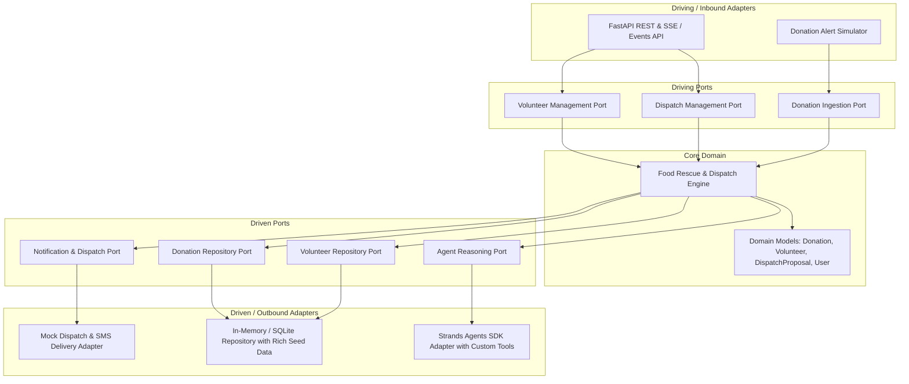

# Implementation Plan: PantryPulse (Autonomous Food Rescue & Volunteer Dispatch Agent)

An autonomous, background AI agent built with **AWS Strands Agents SDK** for the **Agents for Humans Hackathon (Good Neighbor Track)**. It monitors emergency food rescue alerts (surplus bakery, produce, prepared meals), evaluates cargo and vehicle requirements, selects and ranks candidate volunteers, and surfaces a single high-clarity **Human-in-the-Loop Decision Checkpoint** for the pantry coordinator before executing autonomous dispatch and inventory updates.

## User Review Required

> [!IMPORTANT]
> **Toolchain & Runtime**:
> - Backend: **Python 3.14** managed via **`uv`** for virtual environment creation and ultra-fast dependency management in `pantry-pulse/backend/.venv`.
> - Frontend: **React + TypeScript** via Vite, styled with Tailwind CSS, Lucide icons, and powered by **TanStack Query** (`@tanstack/react-query`) for asynchronous server-state management.
> - Architecture: **Ports & Adapters (Hexagonal Architecture)** ensuring business domain and agent reasoning are cleanly decoupled from web delivery and external services.

---

## In-Depth Platform Flow & Subsystems

### 1. Volunteers Management
- **Domain Attributes**: Tracks ID, name, contact (SMS/email), live GPS coordinates, vehicle classification (`Cargo Bike`, `Compact Sedan`, `Hatchback/SUV`, `Cargo Van/Truck`), cargo capacity in lbs, equipped gear (insulated cold-chain coolers, hand trucks), availability window, weekly shifts count, and rating.
- **Dynamic Lifecycle**: Drivers transition through `AVAILABLE` $\rightarrow$ `DISPATCHED` (awaiting driver acceptance) $\rightarrow$ `ON_ROUTE` $\rightarrow$ `COMPLETED` $\rightarrow$ `AVAILABLE` (or `OFF_DUTY`).
- **Equity & Fatigue Balancing**: Prevents driver burnout by weighting distance against `weeklyShiftsCompleted` during Strands Agent candidate ranking.

### 2. Donations Management
- **Ingestion Channels**: Supermarket/bakery/catering rapid alert form, email intake simulator, or coordinator telephone manual entry.
- **Cargo Classification & Triage**: Captures food category (`Bakery/Dry`, `Fresh Produce`, `Prepared Meals`, `Dairy/Frozen`), volume/weight (lbs), strict pickup deadline (e.g. 90-minute window), and cold-chain/fragility handling rules.
- **State Machine**: `REPORTED` $\rightarrow$ `ANALYZING` (Strands Agent tool evaluation) $\rightarrow$ `PENDING_DECISION` $\rightarrow$ `DISPATCHED` $\rightarrow$ `IN_TRANSIT` $\rightarrow$ `COMPLETED` (or `CANCELLED/EXPIRED`).
- **Inventory Intake**: Automatically increments pantry food rescue counters and calculates community impact (meals rescued, carbon offset).

### 3. Dispatches & The Human-in-the-Loop Gate
- **Autonomous Reasoning**: Strands Agent evaluates distance, vehicle cargo volume, cold-chain compatibility, and driver equity. Generates a structured proposal:
  - **Primary Recommendation**: Top matching driver with clear rationale.
  - **Alternative Candidate**: Viable backup driver.
  - **Risk / Trade-off Assessment**: Transparent explanation of why Primary was chosen over Alternative.
- **Human-in-the-Loop Gate (The Core UX)**: Coordinator sees a clean decision card with 1-click actions:
  - `[Approve Primary Driver]` $\rightarrow$ triggers automated dispatch execution.
  - `[Switch to Alternative Driver]` $\rightarrow$ updates assignment.
  - `[Decline / Custom Override]` $\rightarrow$ coordinator handles manually.
- **Custody Verification**: Generates a 4-digit pickup code that the driver presents to the donor upon arrival to guarantee food safety chain of custody.

### 4. Notifications Engine
- **Volunteer Dispatch**: Immediate SMS / Push alert with pickup window, donor address, cargo details, and 1-tap accept link.
- **Donor ETA Reassurance**: Automated notification to donor with driver ETA, vehicle model/color, and pickup code.
- **Coordinator Critical Ping**: Audio/visual cue on mission control dashboard when a critical time-sensitive decision is awaiting approval.

### 5. Roles & Personas
- **Pantry Coordinator (Administrator)**: Mission control desktop dashboard; supervises live operations, approves/overrides agent decisions, manages volunteer fleet and operational settings.
- **Intake Staff (Dock Worker)**: Loading dock tablet view; inspects arriving donations, logs confirmed weight, stamps food safety check.
- **Volunteer Driver**: Mobile-first mission screen; accepts dispatches, gets turn-by-turn routing, enters pickup code, and confirms delivery.
- **Food Donor Partner (Supermarket / Bakery Manager)**: Rapid 30-second surplus submission portal with tax-deductible receipt records and community impact summaries.

---

## System Architecture: Ports & Adapters (Hexagonal)



---

## Directory Layout

```
pantry-pulse/
├── backend/
│   ├── .venv/                         # Python 3.14 virtual environment via uv
│   ├── pyproject.toml / requirements.txt
│   ├── src/
│   │   ├── domain/                    # Pure domain models & business rules
│   │   │   ├── __init__.py
│   │   │   ├── models.py              # Donation, Volunteer, DispatchProposal, Decision, User
│   │   │   └── exceptions.py
│   │   ├── ports/                     # Abstractions / Contracts
│   │   │   ├── __init__.py
│   │   │   ├── driving/               # Inbound use case ports
│   │   │   │   ├── donation_use_case.py
│   │   │   │   ├── dispatch_use_case.py
│   │   │   │   └── volunteer_use_case.py
│   │   │   └── driven/                # Outbound SPI ports
│   │   │       ├── agent_port.py
│   │   │       ├── volunteer_repo_port.py
│   │   │       ├── donation_repo_port.py
│   │   │       └── notification_port.py
│   │   ├── core/                      # Application service implementations
│   │   │   ├── __init__.py
│   │   │   └── services.py            # Orchestrates domain logic, agent reasoning, and repo calls
│   │   ├── adapters/                  # Implementations of ports
│   │   │   ├── inbound/
│   │   │   │   └── rest/
│   │   │   │       ├── app.py         # FastAPI application
│   │   │   │       └── routes.py      # /alerts, /decisions, /volunteers, /simulate
│   │   │   └── outbound/
│   │   │       ├── agent/
│   │   │       │   ├── strands_agent.py   # Strands Agents SDK integration
│   │   │       │   └── tools.py           # Custom @tool definitions for cargo eval & matching
│   │   │       ├── persistence/
│   │   │       │   └── in_memory_repo.py  # Seeded volunteers, mock donation history
│   │   │       └── notification/
│   │   │           └── mock_notifier.py   # Simulated SMS & Webhook dispatcher
│   │   └── main.py                    # Composition root & server startup
├── frontend/
│   ├── package.json
│   ├── tsconfig.json
│   ├── vite.config.ts
│   ├── src/
│   │   ├── api/                       # TanStack Query hooks & client
│   │   │   ├── client.ts
│   │   │   ├── useDonations.ts
│   │   │   ├── useDecisions.ts
│   │   │   └── useVolunteers.ts
│   │   ├── components/
│   │   │   ├── DecisionGateModal.tsx   # The Core 'Human-in-the-Loop' action card
│   │   │   ├── LiveAlertFeed.tsx       # Incoming surplus alerts feed
│   │   │   ├── VolunteerFleet.tsx      # Active volunteer drivers & vehicle capacities
│   │   │   ├── AgentAuditLog.tsx       # Strands Agent reasoning steps & tool traces
│   │   │   ├── RoleSwitcher.tsx        # Toggle between Coordinator, Driver, Intake, and Donor views
│   │   │   └── Header.tsx
│   │   ├── types/                     # Shared TypeScript interfaces
│   │   ├── App.tsx
│   │   └── main.tsx
├── docs/
│   └── platform_flow.md               # Standalone comprehensive architecture & lifecycle doc
└── README.md
```

---

## Verification Plan

### Automated Verification
- Unit test suite: `pytest tests/` covering domain models, matching logic, and decision transitions.
- Frontend build & type-check: `npm run build` in `frontend/`.
- API endpoint validation: Verify endpoints return correct schemas.

### Manual / Hackathon Demo Verification
- Simulate an incoming donation alert (e.g. 60 boxes bakery items, 1-hour window).
- Verify the Strands Agent processes the alert in the background, runs tool evaluations, and generates a structured proposal.
- Observe the **Decision Gate** appear in the coordinator dashboard with clear rationale.
- Click **Approve**, verify dispatch notification fires, status updates in real-time via TanStack Query, and inventory metrics update.
